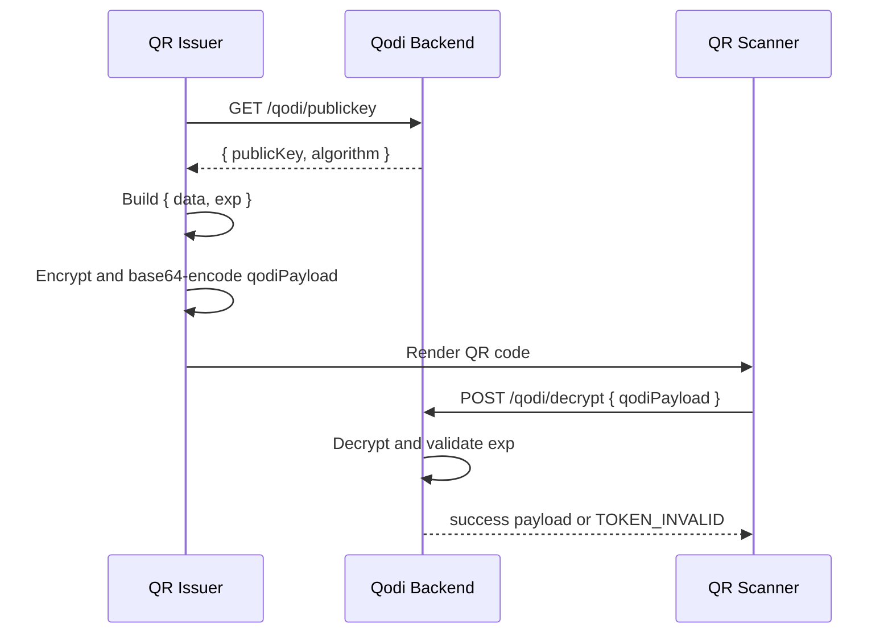

# Qodi

Qodi is a backend service for encrypted, time-limited QR codes. Clients fetch a public key from Qodi, encrypt a payload that includes an expiration timestamp, encode the ciphertext as a QR code, and later call Qodi to decrypt it. The private key never leaves the server.

This design solves a specific problem that normal QR codes do not address: standard QR codes are static, readable by anyone, and effectively permanent. Qodi makes the QR payload unreadable to scanners on its own and enforces expiration server-side from inside the encrypted payload.

## Why Use Qodi

Use Qodi when you need QR codes to behave more like short-lived secure tokens than static labels.

Typical use cases:
- check-in or admission tokens that should stop working after a narrow time window
- QR-mediated device handoff flows where the QR should reveal nothing to an arbitrary scanner
- temporary access artifacts for internal tools, kiosks, or staff workflows
- deployments where QR generation must happen on untrusted clients but decryption must remain centralized

What Qodi gives you:
- asymmetric encryption so clients only need the public key
- server-enforced expiration embedded inside the encrypted payload
- a simple decryption API that intentionally does not distinguish expired from malformed ciphertext
- deploy-time authentication modes that fit simple deployments and larger identity setups
- OpenAPI-driven route binding and request validation through [api/openapi.yaml](/Users/daniellmorris/work/gigaplay/os/qodi/api/openapi.yaml)

QR encryption algorithms:
- default and recommended: `RSA-OAEP-SHA256`
- supported by the backend: `RSA-OAEP`, `RSA-OAEP-SHA256`, `RSA-OAEP-SHA384`, `RSA-OAEP-SHA512`
- verified in end-to-end tests: all four supported algorithms

Tradeoffs:
- decrypting a QR requires a network round-trip to the backend
- the backend and its private key are the trust anchor for the entire system
- Qodi does not implement replay prevention or revocation for individual QR codes, though the practical risk is reduced when deployments keep expirations short

## API Surfaces

Qodi exposes four HTTP surfaces:
- `GET /qodi/publickey` returns the PEM public key and algorithm identifier used by clients for encryption
- `POST /qodi/decrypt` decrypts a base64-encoded `qodiPayload`, validates expiration, and returns either the payload or `TOKEN_INVALID`
- `GET /qodi/servertime` returns the server's current epoch-millisecond and ISO timestamps so QR issuers can align expirations with server time
- `GET /health` provides an operational liveness endpoint for the service itself

The Qodi endpoints are authenticated. `/health` is intentionally left unauthenticated for orchestration and health checks.

## Request Flow



## How It Works

1. A client authenticates to `GET /qodi/publickey` and receives the current public key plus the configured encryption algorithm.
2. The client builds a JSON payload like `{ "data": ..., "exp": 1745000000 }`.
3. The client serializes and encrypts that JSON with the public key, base64-encodes the ciphertext, and places the result into a QR code.
4. A scanner reads the QR code and sends the base64 ciphertext to `POST /qodi/decrypt`.
5. Qodi decrypts the ciphertext with the private key, validates the embedded `exp`, and returns either the original payload or `{ "success": false, "error": "TOKEN_INVALID" }`.

The expiration is protected because it lives inside the encrypted payload. A caller cannot extend the lifetime of a code without invalidating the ciphertext.

## Authentication Modes

Exactly one auth mode is active per deployment.

### `static-token`

Requests must send a pre-shared bearer token. This is the simplest deployment mode and works well for tightly controlled internal clients.

### `jwt-static`

Requests must send a JWT that Qodi validates against a configured static HMAC secret or public key PEM. This is appropriate when your environment already issues JWTs and does not need JWKS rotation.

### `jwt-jwks`

Requests must send a JWT whose signing key is resolved from a remote JWKS endpoint. Qodi caches the JWKS and refreshes it when needed. This is the best fit for identity-provider-backed deployments with rotating keys.

## Examples

| Example | Description |
|---|---|
| [Flutter demo](examples/flutter-demo) | Mobile app that fetches the public key, generates encrypted QR payloads, renders them, and scans and decrypts them via the backend |

See the [Getting Started guide](docs/getting-started.md) for instructions on running the Flutter demo alongside the backend.

## Docs

- [Getting Started](docs/getting-started.md) — step-by-step guide for running the backend with Docker Compose and running the Flutter demo app
- [Architecture](docs/architecture.md) — implementation-oriented reference covering the API surface, auth modes, encryption model, request flow, and error handling

## Configuration

### Core Settings

| Variable | Required | Description |
| --- | --- | --- |
| `QODI_PORT` | No | HTTP port for the server. Defaults to `8080`. |
| `QODI_ALGORITHM` | Yes | Encryption algorithm identifier returned to clients. Supported values: `RSA-OAEP`, `RSA-OAEP-SHA256`, `RSA-OAEP-SHA384`, `RSA-OAEP-SHA512`. Recommended default: `RSA-OAEP-SHA256`. |
| `QODI_PRIVATE_KEY` | Yes if `QODI_PRIVATE_KEY_PATH` unset | PEM-encoded private key used for decryption. |
| `QODI_PRIVATE_KEY_PATH` | Yes if `QODI_PRIVATE_KEY` unset | Filesystem path to the private key PEM. |
| `QODI_PUBLIC_KEY` | Yes if `QODI_PUBLIC_KEY_PATH` unset | PEM-encoded public key distributed to clients. |
| `QODI_PUBLIC_KEY_PATH` | Yes if `QODI_PUBLIC_KEY` unset | Filesystem path to the public key PEM. |
| `QODI_CLOCK_SKEW_SECONDS` | No | Optional expiration grace window. Defaults to `0`. |

## Encryption Algorithm Primer

Qodi uses **RSA-OAEP**, an asymmetric encryption scheme. The client encrypts with the public key; only the server can decrypt with the private key. The four supported algorithm identifiers refer to the same RSA-OAEP scheme with different hash functions used internally by the padding:

| Algorithm | Hash | Recommendation |
|---|---|---|
| `RSA-OAEP` | SHA-1 | Avoid — SHA-1 is deprecated and will flag security audits |
| `RSA-OAEP-SHA256` | SHA-256 | **Recommended default** — universally supported, no known weaknesses |
| `RSA-OAEP-SHA384` | SHA-384 | Use only if a compliance framework explicitly requires it |
| `RSA-OAEP-SHA512` | SHA-512 | Use only if a compliance framework explicitly requires it |

A few things worth understanding when choosing:

**The hash is not the binding security constraint.** Your RSA key length (2048-bit minimum, 4096-bit for long-lived keys) and the protection of the private key matter far more than whether you use SHA-256 or SHA-512 inside OAEP. The practical security difference between the SHA-256, SHA-384, and SHA-512 variants is negligible for this use case.

**SHA-1 is the exception.** SHA-1 collision attacks are well-documented. Even though the theoretical attack path against OAEP specifically is different from signature forgery, SHA-1 is broadly deprecated across the industry and will draw scrutiny in audits. Avoid `RSA-OAEP` (the SHA-1 variant) in new deployments.

**Client library support varies.** SHA-256 OAEP is exposed in every modern crypto library — the Web Crypto API, OpenSSL, PointyCastle, and others. SHA-384 and SHA-512 OAEP are less consistently available. If you are integrating a client you do not control, confirm it supports the algorithm before changing from the default.

**`RSA-OAEP-SHA256` is the right default.** It is what the examples use, what the `.env.example` configures, and what you should use unless a specific external requirement forces another choice.

### Auth Settings

| Variable | Required | Description |
| --- | --- | --- |
| `QODI_AUTH_MODE` | Yes | `static-token`, `jwt-static`, or `jwt-jwks` |
| `QODI_STATIC_TOKEN` | If `static-token` | Shared bearer token used for constant-time comparison |
| `QODI_JWT_SECRET` | If `jwt-static` | HMAC secret or public key PEM for JWT validation |
| `QODI_JWT_ALGORITHM` | No | JWT algorithm for `jwt-static`. Defaults to `HS256`. |
| `QODI_JWT_ISSUER` | No | Expected JWT issuer |
| `QODI_JWT_AUDIENCE` | No | Expected JWT audience |
| `QODI_JWKS_URI` | If `jwt-jwks` | Remote JWKS endpoint |
| `QODI_JWKS_CACHE_TTL` | No | JWKS cache duration in seconds. Defaults to `300`. |

## OpenAPI-Driven Structure

Qodi keeps the contract and runtime wiring aligned through the OpenAPI document.

- [api/openapi.yaml](/Users/daniellmorris/work/gigaplay/os/qodi/api/openapi.yaml) defines the routes, validation rules, security scheme, examples, and controller bindings
- [src/middlewares/openapi.middleware.ts](/Users/daniellmorris/work/gigaplay/os/qodi/src/middlewares/openapi.middleware.ts) uses `express-openapi-validator` with `operationHandlers`
- [scripts/generate-controllers.js](/Users/daniellmorris/work/gigaplay/os/qodi/scripts/generate-controllers.js) can scaffold controller files from the spec when new operations are added
- [src/types/schema.d.ts](/Users/daniellmorris/work/gigaplay/os/qodi/src/types/schema.d.ts) is generated from the OpenAPI document and drives typed request and response helpers

This means the OpenAPI contract is not just documentation. It determines routing and validation behavior.

## Development

Useful commands:

```bash
npm run dev
npm run gen-types
npm run gen-controllers
npm run type-check
npm run lint
npm run format:check
npm run validate
```

## Implementation Layout

- [src/controllers/qodiController.ts](/Users/daniellmorris/work/gigaplay/os/qodi/src/controllers/qodiController.ts): public key, decrypt, and server time endpoints
- [src/controllers/healthController.ts](/Users/daniellmorris/work/gigaplay/os/qodi/src/controllers/healthController.ts): health endpoint
- [src/services/qodi.service.ts](/Users/daniellmorris/work/gigaplay/os/qodi/src/services/qodi.service.ts): key loading, decrypt flow, expiration checks, and server time
- [src/services/auth.service.ts](/Users/daniellmorris/work/gigaplay/os/qodi/src/services/auth.service.ts): deployment-mode authentication and JWKS caching
- [src/config/env.validation.ts](/Users/daniellmorris/work/gigaplay/os/qodi/src/config/env.validation.ts): environment validation and startup guardrails

## Limits And Risks

- Private key compromise breaks the trust model and exposes all ciphertexts that can still be recovered with that key.
- Qodi does not provide per-code revocation. If you need revocation, track it in the calling application.
- Qodi does not provide single-use semantics. Replay protection is an application concern.
- Large encrypted payloads produce denser QR codes and can hurt scan reliability.
