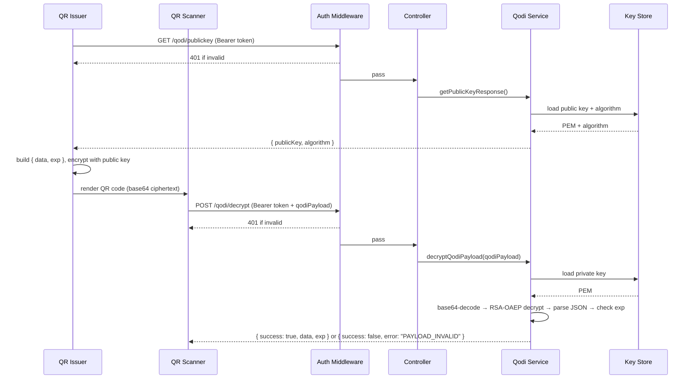

# Qodi Architecture

This document translates the original theory-of-operations document into an implementation-oriented architecture reference for the current Qodi codebase.

It serves two purposes:
- preserve the product and security intent behind Qodi
- describe what the repository actually implements today, including narrowed scope and current constraints

## 1. System Purpose

Qodi is a backend service for encrypted, time-limited QR code workflows.

The central idea is simple:
- clients fetch a public key from Qodi
- clients encrypt a payload that includes an expiration timestamp
- clients encode the encrypted blob into a QR code
- scanners send that encrypted blob back to Qodi
- Qodi decrypts it, validates expiration against server time, and returns either the protected payload or a generic invalid result

This is intentionally different from normal QR code usage. Standard QR codes are static and readable by any scanner. Qodi makes the QR payload unreadable without the backend and enforces expiration server-side using data protected inside the ciphertext.

## 2. High-Level Components

The current implementation is organized around four logical components.

### 2.1 API Layer

The API surface is defined in [api/openapi.yaml](/Users/daniellmorris/work/gigaplay/os/qodi/api/openapi.yaml) and wired into Express through `express-openapi-validator`.

The OpenAPI document is not only documentation. It also defines:
- route registration
- request validation
- controller binding through `x-eov-operation-handler` and `x-eov-operation-id`
- generated TypeScript request and response types

Primary runtime entrypoints:
- [src/index.ts](/Users/daniellmorris/work/gigaplay/os/qodi/src/index.ts)
- [src/middlewares/openapi.middleware.ts](/Users/daniellmorris/work/gigaplay/os/qodi/src/middlewares/openapi.middleware.ts)
- [scripts/generate-controllers.js](/Users/daniellmorris/work/gigaplay/os/qodi/scripts/generate-controllers.js)

### 2.2 Auth Layer

Authentication is applied to `/qodi/*` routes before controller logic executes.

The implementation supports exactly three deployment-time modes:
- `static-token`
- `jwt-static`
- `jwt-jwks`

Implementation:
- [src/services/auth.service.ts](/Users/daniellmorris/work/gigaplay/os/qodi/src/services/auth.service.ts)
- [src/middlewares/auth.middleware.ts](/Users/daniellmorris/work/gigaplay/os/qodi/src/middlewares/auth.middleware.ts)

The `/health` endpoint is intentionally unauthenticated.

### 2.3 Key Store

Qodi loads asymmetric key material at startup from either:
- inline environment variables
- filesystem paths

Current inputs:
- `QODI_PRIVATE_KEY` or `QODI_PRIVATE_KEY_PATH`
- `QODI_PUBLIC_KEY` or `QODI_PUBLIC_KEY_PATH`

The current implementation treats key loading as local process configuration. There is no native integration yet for secrets managers, HSMs, or remote key providers.

Implementation:
- [src/services/qodi.service.ts](/Users/daniellmorris/work/gigaplay/os/qodi/src/services/qodi.service.ts)
- [src/config/env.validation.ts](/Users/daniellmorris/work/gigaplay/os/qodi/src/config/env.validation.ts)

### 2.4 Decryption Engine

The decryption engine:
- accepts a base64 ciphertext
- decrypts it with the configured private key
- parses the decrypted JSON
- validates the embedded `exp` timestamp
- returns either the original payload or `PAYLOAD_INVALID`

Implementation:
- [src/services/qodi.service.ts](/Users/daniellmorris/work/gigaplay/os/qodi/src/services/qodi.service.ts)
- [src/controllers/qodiController.ts](/Users/daniellmorris/work/gigaplay/os/qodi/src/controllers/qodiController.ts)

## 3. Implemented API Surface

The current API surface is intentionally small.

### 3.1 `GET /qodi/publickey`

Purpose:
- distribute the active public key to authorized clients
- tell clients which encryption algorithm identifier to use

Response shape:

```json
{
  "publicKey": "-----BEGIN PUBLIC KEY-----\n...\n-----END PUBLIC KEY-----",
  "algorithm": "RSA-OAEP-SHA256"
}
```

### 3.2 `POST /qodi/decrypt`

Purpose:
- accept a base64-encoded encrypted blob
- decrypt and validate it

Request shape:

```json
{
  "qodiPayload": "<base64 ciphertext>"
}
```

Success response:

```json
{
  "success": true,
  "data": "<original payload>",
  "exp": 1745000000
}
```

Opaque failure response:

```json
{
  "success": false,
  "error": "PAYLOAD_INVALID"
}
```

Important behavioral decision:
- Qodi returns HTTP `200` for both successful decrypts and invalid or expired tokens
- invalid ciphertext, parse failures, and expiration all collapse to the same `PAYLOAD_INVALID` result

That behavior is implemented deliberately to avoid leaking token validity signals through status codes or detailed error messages.

### 3.3 `GET /qodi/servertime`

Purpose:
- expose the backend's current authoritative time
- help issuers compute `exp` values relative to server time instead of local device time

Response shape:

```json
{
  "epochMs": 1745000000000,
  "iso": "2026-04-14T12:00:00.000Z"
}
```

### 3.4 `GET /health`

Purpose:
- operational health checking

This endpoint is outside the authenticated `/qodi/*` surface and is intended for infrastructure probes and local diagnostics.

## 4. Encryption Model

The original design document allowed for RSA-OAEP or an equivalent elliptic-curve scheme such as ECIES. The current implementation is narrower.

### Current implementation

Qodi currently supports RSA private-key decryption using Node.js `crypto.privateDecrypt()` with OAEP padding.

Supported `QODI_ALGORITHM` values:
- `RSA-OAEP`
- `RSA-OAEP-SHA256`
- `RSA-OAEP-SHA384`
- `RSA-OAEP-SHA512`

Internally this is mapped to:
- OAEP padding with SHA-1, SHA-256, SHA-384, or SHA-512 depending on configuration

### Expected plaintext payload

Before encryption, clients are expected to construct JSON like:

```json
{
  "data": "<application-defined value>",
  "exp": 1745000000
}
```

Requirements enforced by the current implementation:
- the decrypted payload must be a JSON object
- the object must contain a `data` property
- `exp` must be an integer

The `data` field is intentionally flexible and may be any JSON-compatible value.

### Current non-goals

The current codebase does not implement:
- ECIES
- algorithm negotiation beyond the configured string returned by `/qodi/publickey`
- key rotation workflows
- multi-key decrypt support

## 5. Expiration Model

Expiration is checked after successful decryption and JSON parsing.

Current logic:
- decrypt token
- parse `{ data, exp }`
- compute `now = floor(Date.now() / 1000)`
- if `now >= exp + QODI_CLOCK_SKEW_SECONDS`, return `PAYLOAD_INVALID`

This means `QODI_CLOCK_SKEW_SECONDS` acts as a post-expiration grace window. In effect, a token remains acceptable until `exp + skew`.

That is consistent with the intended operational goal of tolerating client/server clock drift, but it is worth calling out because the implementation choice is specifically:
- "accept until expiration plus tolerance"
rather than
- "shift current time backward by tolerance"

## 6. Authentication Model

All `/qodi/*` routes require bearer authentication. The deployment selects one mode through `QODI_AUTH_MODE`.

### 6.1 `static-token`

Implementation:
- extract bearer token from `Authorization`
- compare with `QODI_STATIC_TOKEN` using `timingSafeEqual`

Use this for:
- simple internal integrations
- development or staging
- tightly controlled service-to-service usage

### 6.2 `jwt-static`

Implementation:
- parse JWT locally
- require `alg` to match `QODI_JWT_ALGORITHM`
- validate signature with either:
  - HMAC for `HS*`
  - public-key verification for `RS*`
- enforce optional issuer and audience checks
- enforce `exp` and `nbf` if present

Notes:
- the environment variable name `QODI_JWT_SECRET` is used for both HMAC secrets and PEM public keys in this mode
- there is no `iat` validation beyond normal claim parsing

### 6.3 `jwt-jwks`

Implementation:
- parse JWT
- require `kid`
- fetch remote JWKS from `QODI_JWKS_URI`
- cache keys for `QODI_JWKS_CACHE_TTL`
- refresh once if the requested `kid` is not in cache
- verify signature using the resolved JWK
- enforce optional issuer and audience checks

Failure mode:
- JWKS fetch or parse failures surface as `503 Service Unavailable`

## 7. Request Flow



### 7.1 Public Key Retrieval

1. Client calls `GET /qodi/publickey` with bearer auth.
2. Auth middleware validates the request.
3. Controller calls `qodiService.getPublicKeyResponse()`.
4. Service returns the configured public key and algorithm.

### 7.2 Decrypt Flow

1. Scanner or client calls `POST /qodi/decrypt` with bearer auth and `{ qodiPayload }`.
2. Auth middleware validates the request.
3. OpenAPI validator enforces request schema.
4. Controller calls `qodiService.decryptQodiPayload(qodiPayload)`.
5. Service base64-decodes, decrypts, parses JSON, checks expiration, and returns either:
   - `{ success: true, data, exp }`
   - `{ success: false, error: "PAYLOAD_INVALID" }`

### 7.3 Server Time Flow

1. Client calls `GET /qodi/servertime` with bearer auth.
2. Auth middleware validates the request.
3. Controller returns current server time from `qodiService.getServerTime()`.

## 8. Error Model

There are two distinct error families.

### 8.1 Opaque decrypt failures

These are business-level failures returned by `POST /qodi/decrypt` with HTTP `200`:
- malformed base64
- decryption failure
- invalid JSON
- missing `data`
- invalid `exp`
- expired token

All of these return:

```json
{
  "success": false,
  "error": "PAYLOAD_INVALID"
}
```

### 8.2 Transport or infrastructure failures

These use normal HTTP error status codes:
- `400` for OpenAPI request validation failures
- `401` for missing or invalid bearer auth
- `500` for internal configuration or server errors
- `503` for dependency failures such as JWKS fetch failure

Current error handling intentionally hides internal error details from `500` responses.

Implementation:
- [src/middlewares/error.middleware.ts](/Users/daniellmorris/work/gigaplay/os/qodi/src/middlewares/error.middleware.ts)

## 9. Configuration Surface

The current implementation is configured entirely through environment variables.

Core variables:
- `QODI_PORT`
- `QODI_ALGORITHM`
- `QODI_PRIVATE_KEY` or `QODI_PRIVATE_KEY_PATH`
- `QODI_PUBLIC_KEY` or `QODI_PUBLIC_KEY_PATH`
- `QODI_CLOCK_SKEW_SECONDS`

Auth variables:
- `QODI_AUTH_MODE`
- `QODI_STATIC_TOKEN`
- `QODI_JWT_SECRET`
- `QODI_JWT_ALGORITHM`
- `QODI_JWT_ISSUER`
- `QODI_JWT_AUDIENCE`
- `QODI_JWKS_URI`
- `QODI_JWKS_CACHE_TTL`

Validation is performed at startup in:
- [src/config/env.validation.ts](/Users/daniellmorris/work/gigaplay/os/qodi/src/config/env.validation.ts)

## 10. Repository Structure

Relevant implementation files:
- [src/index.ts](/Users/daniellmorris/work/gigaplay/os/qodi/src/index.ts): Express bootstrap and middleware wiring
- [src/controllers/qodiController.ts](/Users/daniellmorris/work/gigaplay/os/qodi/src/controllers/qodiController.ts): Qodi endpoint handlers
- [src/controllers/healthController.ts](/Users/daniellmorris/work/gigaplay/os/qodi/src/controllers/healthController.ts): health handler
- [src/services/qodi.service.ts](/Users/daniellmorris/work/gigaplay/os/qodi/src/services/qodi.service.ts): key loading, decrypt logic, time service
- [src/services/auth.service.ts](/Users/daniellmorris/work/gigaplay/os/qodi/src/services/auth.service.ts): auth mode implementation
- [src/middlewares/auth.middleware.ts](/Users/daniellmorris/work/gigaplay/os/qodi/src/middlewares/auth.middleware.ts): bearer auth gate
- [src/middlewares/error.middleware.ts](/Users/daniellmorris/work/gigaplay/os/qodi/src/middlewares/error.middleware.ts): transport error mapping
- [src/types/api-helpers.ts](/Users/daniellmorris/work/gigaplay/os/qodi/src/types/api-helpers.ts): typed request and response helpers
- [src/types/schema.d.ts](/Users/daniellmorris/work/gigaplay/os/qodi/src/types/schema.d.ts): generated OpenAPI types

## 11. Differences From The Original Theory Document

The original document described the target operating model broadly. The repository currently implements a focused subset.

Implemented today:
- public key distribution
- authenticated decrypt endpoint
- authenticated server time endpoint
- three auth modes
- RSA-OAEP decryption
- server-side expiration enforcement
- opaque invalid-token behavior

Not implemented yet:
- elliptic-curve encryption schemes such as ECIES
- key rotation workflow or overlapping key support
- secret-manager-backed key loading
- replay protection
- per-token revocation
- authorization policies beyond authentication

## 12. Engineering Guidance

If the codebase evolves, this document should stay aligned with implementation rather than drift into aspirational design. In practice that means:
- update this document when auth behavior changes
- update it when supported encryption algorithms change
- update it when key management or rotation changes
- keep it aligned with [api/openapi.yaml](/Users/daniellmorris/work/gigaplay/os/qodi/api/openapi.yaml) and [README.md](/Users/daniellmorris/work/gigaplay/os/qodi/README.md)

If you later add more advanced capabilities, this file should explicitly separate:
- current implementation behavior
- intended future architecture

That separation matters for security-sensitive systems like Qodi because operational assumptions can easily become stale if the docs overstate what the service actually does.
